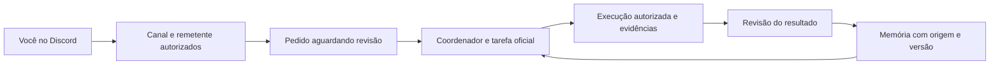

# LCA Coordenação — protótipo local 0.1.0

Um pacote local para consultar o estado do projeto, recuperar experiências com origem e receber pedidos definidos pelo Discord. Construído e testado no Windows; não está instalado no Codex/Drael nem ligado ao Discord.

## Como funciona, em linguagem simples

- O Discord será a porta de entrada. `!lca status` pede um retrato do projeto; `!lca pedir T-003 conferir o recebimento` deixa uma proposta na caixa de entrada.
- A caixa de entrada não executa o texto recebido. O coordenador revisa o pedido e o vincula à tarefa oficial no Notion.
- A memória é um caderno local com fonte, versão e revisão. Um texto guardado começa como candidato. Ter formato correto não torna o conteúdo verdadeiro.
- Codex e Drael podem consultar o mesmo caderno por MCP. A documentação sustenta esse tipo de conexão no Drael CLI; o teste nesse cliente ainda está pendente.



## O que já existe neste pacote

| Parte | Comportamento implementado | Limite |
|---|---|---|
| MCP local | Quatro ferramentas de leitura: estado, pendências, busca e histórico | Testado como processo local; instalação e descoberta em clientes reais pendentes |
| Memória SQLite | Candidatos, revisão separada de formato/fidelidade/utilidade, hashes, escopo e retirada com histórico | Busca por palavras; não há embeddings, treinamento de pesos nem autenticação externa do revisor |
| Discord | Comandos fixos, remetentes autorizados, bloqueio de bots/webhooks, deduplicação e caixa de entrada | Desligado por padrão; nenhum teste de rede real realizado nesta versão |
| Proteção do piloto | Não possui integração com as mensagens existentes; recusa ações novas na segunda entre 08:45 e 09:15, UTC−3 | Janela conservadora deste protótipo; não configura nem audita as automações antigas |

`lca_status` lê um retrato datado, não a saúde atual de todos os serviços. `lca_pending` mostra o inbox local e pendências documentadas; não sincroniza o Notion automaticamente.

## Conferir sem conectar contas

Pré-requisitos: Python 3.11 ou superior e Node 18 ou superior já instalados. Não há pacotes externos. Nesta máquina foram usados Python 3.14.7 e Node 24.22.1. O alias WindowsApps não enxergou os mesmos arquivos e a chamada de script PowerShell foi bloqueada em um teste; o iniciador Node procura o Python real ou aceita `LCA_PYTHON_EXE`, sem mudar a política do Windows.

Na pasta do pacote, execute no PowerShell:

```powershell
node .\scripts\test-lca.mjs
```

Os testes usam dados sintéticos e pastas temporárias, sem OpenAI, Drael ou Discord. O teste MCP inicia o processo, negocia a versão `2025-11-25`, lista as ferramentas e faz consultas inofensivas. Isso não comprova compatibilidade com todos os clientes MCP.

## Conexão local com Codex ou Drael

O `mcp.json` contém o comando real. O caminho `${PLUGIN_ROOT}` deve ser resolvido pelo instalador do plugin. Para um cliente que recebe configuração MCP manual, use o caminho absoluto de `server/launch-mcp.mjs` na máquina, preservando os demais servidores existentes. Não copie o arquivo por cima de configurações existentes.

Exemplo de configuração a adaptar por projeto:

```json
{
  "mcpServers": {
    "lca-coordenacao": {
      "command": "node",
      "args": ["CAMINHO_ABSOLUTO_DO_PACOTE/server/launch-mcp.mjs"]
    }
  }
}
```

O Drael documenta `drael mcp add` e configuração `.mcp.json`. Não foi instalado CLI, autorizada máquina nem criada chave Drael nesta rodada. Não reutilize a chave OpenAI nesse serviço. A versão portátil do plugin não inicia um servidor acessível pela internet nem disponibiliza as ferramentas em web/mobile.

## Preparar o Discord

1. Conferir o bot existente **Drael-LCA**, aplicação `1566599445238390865`. Convite mínimo preparado: ver canais, enviar mensagens e ler histórico; sem administrador.
2. O proprietário precisa renovar a credencial do bot exposta no histórico antigo, diretamente no portal Discord. Nenhuma credencial deve ser colada em chat, repositório ou relatório. Esta etapa é manual; os scripts não renovam nem coletam credenciais.
3. Confirmar servidor, canal dedicado e ID do próprio usuário autorizado. IDs não são segredos. O exemplo contém IDs indicados pelo Drael, ainda sujeitos à conferência de nomes e acesso.
4. Copiar `references/discord.config.example.json` para uma pasta privada fora do repositório, preencher `authorized_user_ids` e registrar as confirmações somente após realizá-las. O exemplo mantém `enabled=false`, `ids_confirmed=false` e `credential_rotation_confirmed=false`.
5. Configurar `LCA_DISCORD_BOT_TOKEN` no ambiente privado do processo, fora do chat. Não há token embutido, leitura de cofre Drael ou busca automática por segredos.
6. Rodar uma vez com `--run --once`, conferir o canal e depois enviar um comando novo. A primeira leitura grava o cursor sem executar o histórico antigo. Sem `--run`, o programa informa que está desligado e não usa rede.

```powershell
$lcaPython = 'CAMINHO_DO_EXECUTAVEL_REAL_DO_PYTHON'
& $lcaPython .\server\discord_bridge.py --config 'CAMINHO_PRIVADO/discord.config.json' --db 'CAMINHO_PRIVADO/discord.db'
# Somente após as confirmações e configuração privada:
& $lcaPython .\server\discord_bridge.py --config 'CAMINHO_PRIVADO/discord.config.json' --db 'CAMINHO_PRIVADO/discord.db' --run --once
```

Para acompanhar continuamente, usar `--run` sem `--once`. Só existe recebimento enquanto esse processo estiver vivo. Parar com Ctrl+C. Não foi instalado serviço, tarefa agendada ou inicialização automática.

Comandos da primeira versão:

| Comando | Efeito |
|---|---|
| `!lca ajuda` | Mostra os comandos disponíveis |
| `!lca status` | Resumo definido do projeto; não promete monitoramento vivo |
| `!lca pendencias` | Contagem de pedidos aguardando revisão |
| `!lca pedir T-003 <texto>` | Guarda proposta de até 500 caracteres, sem executar |

O adaptador verifica servidor/canal/remetente, idade da mensagem e identificador único. Texto com sinais de credenciais é recusado; essa detecção não substitui a orientação de nunca enviar segredos. Menções são desativadas nas respostas. O recebimento não importa anexos nem transforma mensagens em memória aprovada. Um envio com resultado incerto não é repetido automaticamente. Erros 401 e 403 interrompem a execução e continuam sendo classes diferentes.

## Dados e revisão da memória

Estado padrão: `%LOCALAPPDATA%/LCA/coordination`. `LCA_COORDINATION_HOME` permite escolher outra pasta privada. Não coloque o estado no GitHub/OneDrive. Os bancos do protótipo não têm criptografia própria; herdam a proteção da conta e do disco. O pacote não deve receber dados clínicos reais.

A API local `Store` em `server/memory.py` separa `observacao`, `hipotese` e `licao`, com estados `candidato`, `ativo`, `retirado`. A aprovação exige recibo que corresponda aos hashes de fonte/artefato e três avaliações explícitas. Para uma lição geral, a política conservadora exige ao menos duas observações aprovadas sem feedback/supervisão, com grupos de fonte, fontes e saídas distintos. Duas provas são um mínimo deste protótipo, não demonstração estatística ou garantia científica de generalização.

O recibo é informado pelo coordenador: o código confere sua presença e vínculo, não se o revisor existe ou se sua avaliação é verdadeira. As ferramentas MCP não expõem métodos para adicionar ou promover registros. O histórico resiste a alterações pelas APIs/triggers comuns, mas não protege contra um administrador que reescreva todo o banco.

`scripts/init-t002-candidate.py` permite registrar explicitamente o fechamento T-002 como candidato, calculando os hashes da fonte e do JSON escolhido. Não copia a transcrição nem promove o registro; as três avaliações começam pendentes. O protótipo local recebeu esse candidato documental na rodada de preparação.

## Critérios para liberar a próxima etapa

- Testes locais aprovados e revisão do código no GitHub.
- Credencial renovada e guardada fora do chat; acesso do bot confirmado no canal dedicado.
- Remetente autorizado recebe resposta a `!lca status`; outro remetente é recusado; replay do mesmo pedido não cria duplicata.
- Processo contínuo observado e parada comprovada, sem encostar no piloto.
- Drael/Codex recuperam uma experiência pelo MCP no cliente real, antes de qualquer promessa de integração instalada.
- Nova fonte testa o agente sem resposta preselecionada e sem feedback corretivo durante a primeira entrega.
